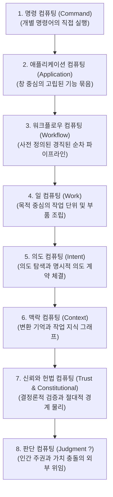
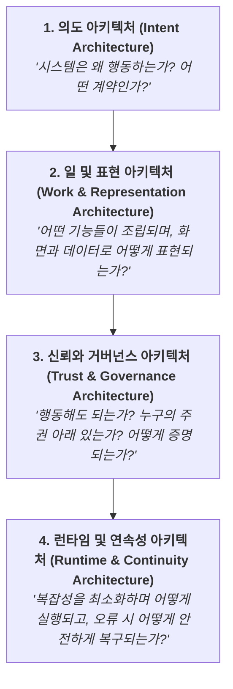
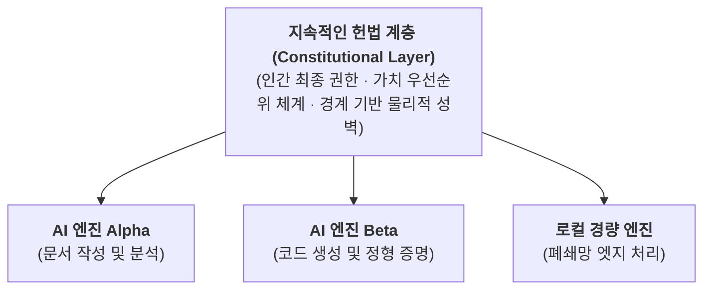

# 판단 컴퓨팅: 시스템 아키텍처 명세 및 운영 모델 (Judgment Computing Architecture)

> **Version 2.0.1** — 2026년 11월  
> **저자**: YL Khim  
> **DOI**: [10.5281/zenodo.23388471](https://doi.org/10.5281/zenodo.23388471)  
> **라이선스**: [Creative Commons Attribution 4.0 International (CC BY 4.0)](https://creativecommons.org/licenses/by/4.0/)

[English Manifesto](README.md) • [한국어 선언문](README.Ko.md) • [Architecture (EN)](ARCHITECTURE.md) • [아키텍처 (KO)](ARCHITECTURE.Ko.md) • [Glossary (EN)](GLOSSARY.md) • [용어집 (KO)](GLOSSARY.Ko.md)

---

## 1. 8단계 컴퓨팅 진화 패러다임

컴퓨팅의 역사는 인간의 의도와 기계의 실행 사이에서 발생하는 '번역 비용(Translation Cost)'을 줄여온 추상화의 역사다. 각 패러다임은 이전 단계의 복잡성을 흡수하며 상위 원시 단위(Primitive)를 도입한다:



---

## 2. 4대 직교 핵심 아키텍처 (Four Orthogonal Architectures)

판단을 인식하는 컴퓨팅(Judgment-Aware Computing)을 구현하기 위해, 시스템은 상호 독립적이면서 조화롭게 맞물리는 4개의 직교 아키텍처 계층을 통해 4가지 근본 질문에 답해야 한다:



### 제1계층: 의도 아키텍처 (Intent Layer — Why & Contract)
- **암묵적 의도 탐색 (Implicit Intent Discovery)**: 단발성 프롬프트 실행 대신 쌍방향 대화를 통해 빠진 제약 조건, 위험 프로필, 숨겨진 목적을 명확히 드러낸다.
- **명시적 의도 계약 (Explicit Intent Contract)**: 모호한 대화형 요구사항을 법적·기술적으로 구속력 있는 실행 명세서로 컴파일한다.
- **의도 보존 (Intent Preservation)**: 하위 최적화 엔진, 라우팅 도구, 자율 에이전트가 실행 도중 인간의 원래 의도를 왜곡하거나 임의로 변경하지 못하도록 보장한다.

### 제2계층: 일 및 표현 아키텍처 (Work & Representation Layer — What & Memory)
- **작업 단위와 조립 (Work Units & Composition)**: 거대 애플리케이션을 모듈형 기능 부품(*Components*)과 행동 규칙(*Boundaries*)으로 해체하고 재조립한다. 작업 단위는 더 큰 작업 단위 속에 재귀적으로 중첩될 수 있다(*Recursive Work Nesting*).
- **삼중 렌즈 시맨틱 표현 (Tri-View Semantic Representation)**: 하나의 정형화된 정본(Canonical) 의미 모델을 사용자의 숙련도에 맞춰 실시간 동기화되는 세 가지 뷰로 투영한다:
  1. *초심자 렌즈 (Beginner Lens)*: 단순한 토글 스위치와 직관적인 양식 UI.
  2. *중급자 렌즈 (Intermediate Lens)*: 시각적 흐름도(플로우차트) 및 부품 간 경계 배선 다이어그램.
  3. *전문가 렌즈 (Expert Lens)*: 정밀한 선언적 규칙 코드 및 경계 명세 스크립트.
- **변환의 기억 (Transformation Memory)**: 휘발적인 대화 텍스트 덤프 대신 일(Work)이 진화해 온 구조적 궤적을 보존한다. 작업의 이유와 변화 과정(`원시 로그` → `패턴 발견` → `재사용 가능한 작업 지식`)을 지속적인 지식으로 증류함으로써, 대화 문맥의 비대화와 왜곡을 방지하고 장기적인 맥락 연속성을 유지한다.

### 제3계층: 신뢰와 거버넌스 아키텍처 (Trust & Governance Layer — Authority & Constitution)
- **규범적 위계 질서 (Normative Hierarchy)**:
  > **인간 주권 (Human Sovereignty) → 가치 (Values) → 원칙 (Principles) → 헌법 (Constitution) → 정책 (Policies) → 런타임 (Runtime)**
- **정책보다 물리 (Physics Over Policy)**: 프롬프트 경고나 사후 감사 규정에 의존하지 않고, 아키텍처적 위상(Topology) 구조 자체에서 비인가 경로를 차단한다. 허가되지 않은 통로로는 데이터와 권한이 물리적으로 흐를 수 없다.
- **신뢰에 앞서는 검증 (Verification Before Trust)**: 지능적 생성 능력과 형식적 평가 권한을 엄격히 분리한다. 증명할 수 있는 것은 결정론적으로 증명하고, 나머지에 한해 의미론적 신뢰도 점수로 보완한다.
- **개입의 비대칭 (Asymmetric Intervention, 이해를 돕기 위한 예시 비율 90 : 8 : 2)**:
  - **대부분(예: 90%) 침묵 실행 (Silent Execution)**: 사전 검증되고 경계 내부로 격리된 일상적 작업은 사용자를 방해하지 않고 조용히 완수된다.
  - **일부(예: 8%) 주변 인지 (Ambient Awareness)**: 경미한 변형이나 안전한 예외 상황은 작업을 차단하지 않는 가벼운 프리뷰나 알림으로 표출된다.
  - **소수(예: 2%) 동기식 승인 게이트 (Synchronous Gate)**: 되돌릴 수 없는 행동, 다중 원칙 간의 충돌, 헌법적 경계 침범 시에는 즉각 실행을 멈추고 인간의 판단을 요청한다.
- **설명 가능한 예외와 판례 (Justified Override & Precedents)**: 위기 상황 시 권한을 가진 인간이 표준 규칙을 일시적으로 우회할 수 있도록 지원하되, 시스템이나 헌법을 몰래 바꾸지 않고 감수된 위험과 정당화 사유를 불변의 판례(Precedent)로 기록하여 투명하게 감사한다.

### 제4계층: 런타임 및 연속성 아키텍처 (Runtime & Continuity Layer — How & Resilience)
- **결정론적 오케스트레이션 (Deterministic Orchestration)**: 런타임 실행 엔진은 스스로 가치를 고민하거나 판단하지 않는다. 상위 계층에서 컴파일된 실행 그래프를 엄격히 집행하는 집행관(*Orchestrator, Not Judge*)의 역할만 수행한다.
- **1회 컴파일, 1회 검증, N회 실행 (Compile Once, Verify Once, Execute Many)**: 비용이 많이 드는 의미론적 협상과 검증은 실행 전에 1회만 수행하고, 런타임은 지연 없는 고속·검증 완료 상태로 반복 실행한다.
- **일의 연속성과 다계층 복구 (Work Continuity & Recovery)**: 장애 발생 시 단순히 다운된 부품 프로세스를 재부팅하는 것이 아니라, 사용자의 **일(Work)과 의도(Intent)** 전체의 맥락을 복구 대상으로 삼는다.
  - *Tier 1 (사전 승인된 대체 풀)*: 계약 범위 내에서 시스템이 자율적으로 안전한 대체 도구나 파이프라인으로 우회 실행.
  - *Tier 2 (거버넌스 재승인)*: 계약 범위를 벗어나는 돌발 변수는 인간 권한으로 에스컬레이션하여 판단을 구함.

---

## 3. 점진적 활성화 모델 (Progressive Activation) (L0 ~ L4)

인지적 과부하와 불필요한 시스템 복잡성을 방지하기 위해 다음과 같은 설계 원칙을 준수한다:  
> **목적 달성에 필요한 최소한의 복잡성만 활성화한다 (Activate the minimum complexity required for success).**

```text
Level 4: 형식 검증 거버넌스 및 다계층 자율 복구 (Formal Verification & Resilience)
         ▲
Level 3: 맥락 지식 및 헌법 거버넌스 검증 (Context Knowledge & Constitution)
         ▲
Level 2: 경계 실행 (동적 조건부 라우팅 및 데이터 변환 규칙)
         ▲
Level 1: 작업 표면 조립 (모듈형 기능 부품의 직관적 결합)
         ▲
Level 0: 명령 실행 (단일 도구 / 단발성 액션 직접 호출)
```

하위 레벨은 상위 레벨의 무거운 시스템에 의존하지 않는다. 단순한 텍스트 저장이나 파일 열기는 거버넌스 검증기나 복구 서브시스템을 로드하지 않고 Level 0에서 즉각 완료된다.

---

## 4. 헌법 보존과 엔진 교체 (Preserve the Constitution, Replace the Engines)



AI 모델의 아키텍처, 추론 엔진, LLM 가중치는 빠르게 변화하고 주기적으로 도태된다. 반면 시스템의 헌법 계층(최상위 규범과 경계 성벽)은 모델 바깥에 독립적으로 보존되며 모델 자체에 의해 변조될 수 없다. 시스템은 웹 브라우저를 교체하듯 AI 엔진을 자유롭게 교체하지만, 시스템을 지배하는 헌법과 인간 주권은 변함없이 유지된다.

---

## 5. 인용 및 지적 재산권 고지

본 아키텍처 프레임워크는 시스템 엔지니어링 분야에서 개념적 선점(Prior Art)을 확립하고 벤더 종속 없는 개방형 생태계를 구축하기 위해 공개 명세서 형태로 발행되었습니다.

```bibtex
@article{khim2026judgmentarchitecture,
  author       = {Khim, Y. L.},
  title        = {Judgment Computing: Architectural Specification and Operating Model},
  year         = {2026},
  month        = nov,
  publisher    = {Zenodo},
  version      = {2.0.1},
  doi          = {10.5281/zenodo.23388471},
  url          = {https://doi.org/10.5281/zenodo.23388471}
}
```

본 문서는 **[Creative Commons Attribution 4.0 International (CC BY 4.0)](https://creativecommons.org/licenses/by/4.0/)** 라이선스에 따라 이용할 수 있습니다.
