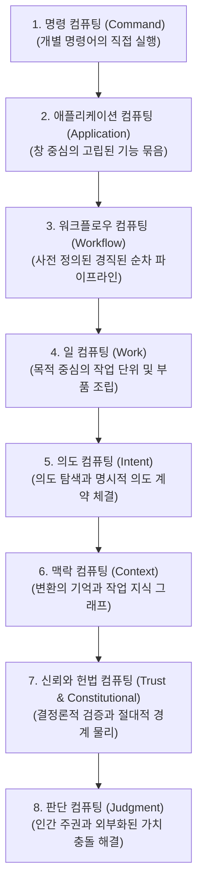
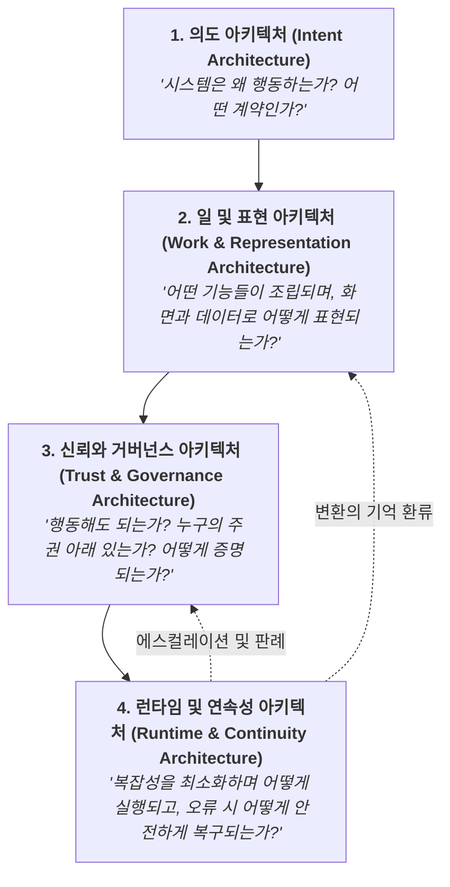
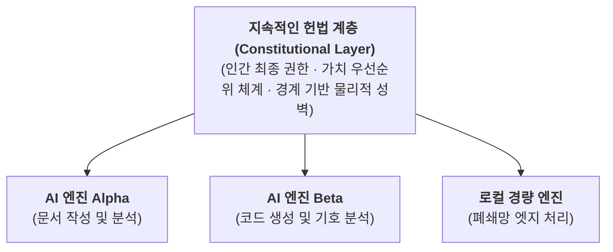

# 판단 컴퓨팅: 시스템 아키텍처 명세 및 운영 모델 (Judgment Computing Architecture)

> **Version 2.2.0** — 2026년 11월  
> **저자**: YL Khim  
> **DOI**: [10.5281/zenodo.23388470](https://doi.org/10.5281/zenodo.23388470)  
> **라이선스**: [Creative Commons Attribution 4.0 International (CC BY 4.0)](https://creativecommons.org/licenses/by/4.0/)  
> **문서 성격**: 실험적·진화 중인 개념 아키텍처 명세 (*제1~4장은 출간 단행본 부록 A·B에 수록된 `v2.0.1` 기준선과 대응하며, 제5장 및 세부 표현은 지속적인 검증에 따라 향후 수정·보완·개정될 수 있습니다.*)

[English Manifesto](README.md) • [한국어 선언문](README.Ko.md) • [Architecture (EN)](ARCHITECTURE.md) • [아키텍처 (KO)](ARCHITECTURE.Ko.md) • [Glossary (EN)](GLOSSARY.md) • [용어집 (KO)](GLOSSARY.Ko.md)

---

## 1. 8단계 컴퓨팅 진화 패러다임

컴퓨팅의 역사는 인간의 의도와 기계의 실행 사이에서 발생하는 '번역 비용(Translation Cost)'을 줄여온 추상화의 역사다. 각 패러다임은 이전 단계의 복잡성을 흡수하며 상위 원시 단위(Primitive)를 도입하며, 이는 엄격한 연대기적 역사 순서라기보다 번역 비용을 줄여 온 **개념적 추상화 계층 사다리**를 나타낸다:



---

## 2. 4대 직교 핵심 아키텍처 (Four Orthogonal Architectures)

판단을 인식하는 컴퓨팅(Judgment-Aware Computing)을 구현하기 위해, 시스템은 상호 독립적이면서 조화롭게 맞물리는 4개의 직교 아키텍처 계층을 통해 4가지 근본 질문에 답해야 한다:



### 제1계층: 의도 아키텍처 (Intent Layer — Why & Contract)
- **암묵적 의도 탐색 (Implicit Intent Discovery)**: 단발성 프롬프트 실행 대신 쌍방향 대화를 통해 빠진 제약 조건, 위험 프로필, 숨겨진 목적을 명확히 드러낸다.
- **명시적 의도 계약 (Explicit Intent Contract)**: 모호한 대화형 요구사항을 운영상·기술적으로 구속력 있는 실행 명세서로 컴파일한다.
- **의도 보존 (Intent Preservation)**: 하위 최적화 엔진, 라우팅 도구, 자율 에이전트가 실행 도중 인간의 원래 의도를 왜곡하거나 임의로 변경하지 못하도록 보장한다.

### 제2계층: 일 및 표현 아키텍처 (Work & Representation Layer — What & Memory)
- **작업 단위와 조립 (Work Units & Composition)**: 거대 애플리케이션을 모듈형 기능 부품(*Components*)과 행동 규칙(*Boundaries*)으로 해체하고 재조립한다. 작업 단위는 더 큰 작업 단위 속에 재귀적으로 중첩될 수 있다(*Recursive Work Nesting*).
- **삼중 렌즈 시맨틱 표현 (Tri-View Semantic Representation)**: 하나의 정형화된 정본(Canonical) 의미 모델을 사용자의 숙련도에 맞춰 비대칭적으로 동기화·투영되는 세 가지 뷰로 제공한다(고급 규칙의 초심자 뷰 노출은 손실 없는 프리셋·매개변수 투영으로 한정):
  1. *초심자 렌즈 (Beginner Lens)*: 단순한 토글 스위치와 직관적인 양식 UI.
  2. *중급자 렌즈 (Intermediate Lens)*: 시각적 흐름도(플로우차트) 및 부품 간 경계 배선 다이어그램.
  3. *전문가 렌즈 (Expert Lens)*: 정밀한 선언적 규칙 코드 및 경계 명세 스크립트.
- **변환의 기억 (Transformation Memory)**: 휘발적인 대화 텍스트 덤프 대신 일(Work)이 진화해 온 구조적 궤적을 보존한다. 작업의 이유와 변화 과정(`원시 로그` → `패턴 발견` → `재사용 가능한 작업 지식`)을 지속적인 지식으로 증류함으로써, 대화 문맥의 비대화와 왜곡을 방지하고 장기적인 맥락 연속성을 유지한다.

### 제3계층: 신뢰와 거버넌스 아키텍처 (Trust & Governance Layer — Authority & Constitution)
- **규범적 위계 질서 (Normative Hierarchy)**:
  > **인간 주권 (Human Sovereignty) → 가치 (Values) → 원칙 (Principles) → 헌법 (Constitution) → 정책 (Policies) → 런타임 (Runtime)**
- **정책보다 물리 (Physics Over Policy)**: 프롬프트 경고나 사후 감사 규정에만 의존하지 않고, 정의된 위협 모델과 집행·위상(Topology) 아키텍처 수준에서 비인가 경로 자체를 구조적으로 차단해 정당한 실행 통로를 제공하지 않는다. 허가된 채널 내부의 의미론적·페이로드 수준 위험은 런타임 검증과 인간 판단 게이트로 보완한다.
- **신뢰에 앞서는 검증 (Verification Before Trust)**: 지능적 생성 능력과 형식적 평가 권한을 엄격히 분리한다. 증명할 수 있는 것은 결정론적으로 증명하고, 나머지에 한해 의미론적 신뢰도 점수로 보완한다.
- **개입의 비대칭 (Asymmetric Intervention, 이해를 돕기 위한 예시 비율 90 : 8 : 2)**:
  - **대부분(예: 90%) 침묵 실행 (Silent Execution)**: 사전 검증되고 경계 내부로 격리된 일상적 작업은 사용자를 방해하지 않고 조용히 완수된다.
  - **일부(예: 8%) 주변 인지 (Ambient Awareness)**: 경미한 변형이나 안전한 예외 상황은 작업을 차단하지 않는 가벼운 프리뷰나 알림으로 표출된다.
  - **소수(예: 2%) 동기식 승인 게이트 (Synchronous Gate)**: 되돌릴 수 없는 행동, 다중 원칙 간의 충돌, 헌법적 경계 침범 시에는 즉각 실행을 멈추고 인간의 판단을 요청한다.
- **설명 가능한 예외와 판례 (Justified Override & Precedents)**: 위기 상황 시 권한을 가진 인간이 시한부·범위 한정적으로 하위 운영 정책을 일시 우회할 수 있도록 지원하되, 헌법을 몰래 바꾸거나 불가침 헌법 바닥·의무 감사 기록·복수 권한자 간 안전 거부권(Fail-Closed Veto)을 무효화할 수 없다. 인간 최종 권한은 인간의 무오류성을 가정하는 것이 아니라, 기계에 양도할 수 없는 책임 귀속과 정당화 사유·불변 판례 기록을 결합해 투명하게 감사하는 구조다.

### 제4계층: 런타임 및 연속성 아키텍처 (Runtime & Continuity Layer — How & Resilience)
- **결정론적 오케스트레이션 (Deterministic Orchestration)**: 런타임 실행 엔진은 스스로 가치를 고민하거나 판단하지 않는다. 상위 계층에서 컴파일된 실행 그래프를 엄격히 집행하는 집행관(*Orchestrator, Not Judge*)의 역할만 수행한다.
- **1회 컴파일, 1회 검증, N회 실행 (Compile Once, Verify Once, Execute Many)**: 비용이 많이 드는 의미론적 협상과 정적 그래프 검증은 실행 전에 1회만 수행하고, 이후 반복 실행에서는 경량 런타임 가드가 동적 권한 유효성과 외부 사전 조건을 매번 재확인(어긋날 경우 즉시 중단)하는 가운데 저지연으로 집행한다.
- **일의 연속성과 다계층 복구 (Work Continuity & Recovery)**: 장애 발생 시 단순히 다운된 부품 프로세스를 재부팅하는 것이 아니라, 사용자의 **일(Work)과 의도(Intent)** 전체의 맥락을 복구 대상으로 삼는다.
  - *Tier 1 (사전 승인된 대체 풀)*: 계약 범위 내에서 시스템이 자율적으로 안전한 대체 도구나 파이프라인으로 우회 실행.
  - *Tier 2 (거버넌스 재승인)*: 계약 범위를 벗어나는 돌발 변수는 인간 권한으로 에스컬레이션하여 판단을 구함.

---

## 3. 점진적 활성화 모델 (Progressive Activation) (L0 ~ L4)

인지적 과부하와 불필요한 시스템 복잡성을 방지하기 위해 다음과 같은 설계 원칙을 준수한다:  
> **목적 달성에 필요한 최소한의 복잡성만 활성화한다 (Activate the minimum complexity required for success).**

```text
Level 4: 인증된 거버넌스 및 다계층 자율 복구 (Certified Governance & Multi-Tier Autonomous Recovery)
         ▲
Level 3: 맥락 지식 및 헌법 거버넌스 검증 (Context Knowledge & Constitution)
         ▲
Level 2: 경계 실행 (동적 조건부 라우팅 및 데이터 변환 규칙)
         ▲
Level 1: 작업 표면 조립 (모듈형 기능 부품의 직관적 결합)
         ▲
Level 0: 명령 실행 (단일 도구 / 단발성 액션 직접 호출)
```

사전 인가된 저위험 로컬 작업에서 하위 레벨은 상위 레벨의 무거운 시스템에 의존하지 않는다. 단순한 텍스트 저장이나 파일 열기는 거버넌스 검증기나 복구 서브시스템을 로드하지 않고 Level 0에서 즉각 완료된다. 단, 외부 부작용·민감 데이터 경계·비신뢰 작업은 상위 계층 검증을 우회하기 위해 임의로 Level 0로 하향 활성화될 수 없다.

---

## 4. 헌법 보존과 엔진 교체 (Preserve the Constitution, Replace the Engines)



AI 모델의 아키텍처, 추론 엔진, LLM 가중치는 빠르게 변화하고 주기적으로 도태된다. 반면 시스템의 헌법 계층(최상위 규범과 경계 성벽)은 모델 바깥에 독립적으로 보존되며 모델 자체에 의해 일방적으로 변조될 수 없다. 헌법 개정은 일상적인 실행 루프 바깥에서 명시적이고 검증 가능한 승인 절차를 거쳐야 하며, 그 엄격함은 개인 환경의 명시적 암호 서명부터 조직 환경의 물리적으로 격리된 다자간 승인까지 맥락에 맞게 적용된다. 시스템은 웹 브라우저를 교체하듯 AI 엔진을 자유롭게 교체하지만, 시스템을 지배하는 헌법과 인간 주권은 변함없이 유지된다.

---

## 5. 핵심 경계 불변 조건 및 설계 보증 (Core Boundary Invariants & Design Guarantees)

> **개념적 보증 범위 및 실험적 고지 (Scope & Experimental Status)**:  
> 본 명세서는 독점적인 런타임 엔진, 세부 검증 알고리즘, 내부 데이터 스키마, 컴파일 파이프라인을 공개하지 않는다. 대신 앞선 4대 핵심 아키텍처를 따르는 모든 판단 인식(Judgment-Aware) 시스템이 구조적으로 충족해야 할 **핵심 보안·연속성 불변 조건(Invariants)**을 개념적 작업 모델로 제시한다. 아래의 경계 조건들은 초기 로컬 프로토타입 실험과 반복적 경계 테스트를 통해 정제되었으나, 완성된 산업 표준·공개 벤치마크 또는 운영 환경의 OS 커널 격리 구현을 대체하지 않는 **실험적 탐구 명세**이므로 향후 검증 결과에 따라 계속 수정·보완·개정될 수 있다.

1. **계약 기준선 앵커링과 다단계 드리프트 방어 (Contract-Anchored Continuity & Drift Defense)**:
   - 상태 전이 델타(Δ)는 단순한 기억 압축 메커니즘을 넘어 실행 전 의도 이탈(Intent Drift)을 탐지하는 연속성 신호로 기능한다.
   - 직전 몇 단계의 짧은 슬라이딩 윈도우만 비교할 경우 여러 단계에 걸쳐 조금씩 비용·범위·데이터 민감도를 높여 가는 다단계 점진적 상승을 놓칠 수 있다. 따라서 표준을 따르는 시스템은 **국소적 전이 델타, 단일 세션 누적 궤적, 그리고 동일 주체의 유계 교차 세션 시간창(bounded cross-session principal windows)을 최초 `명시적 의도 계약(Explicit Intent Contract)`의 불변 기준선과 병행 대조**해야 한다. 사용자의 정당한 업무 전환으로 기준선을 재앵커링할 때에도 단순 확인이 아니라 **원래 계약 대비 유효 권한·데이터 민감도 변화량에 대한 결정론적 요약**을 동반한 **인간의 명시적 가정 전환 확인(Human Assumption Shift Confirmation)**을 거쳐야 한다.

2. **결정론적 능력 요약 검증을 통한 AI 번역 괴리(`Contract–Reality Gap`) 해소**:
   - 확률적 AI가 자연어 요청을 구조화된 실행 계획으로 변환하는 과정에서는 AI의 요약 설명(예: "단순 읽기 전용")과 실제 컴파일된 부작용 사이에 괴리(**Contract–Reality Gap**)가 발생할 수 있다.
   - 반복 실행용 작업 패키지를 승격·인가하기 전에는 AI가 작성한 설명문이 아니라 실행 정의 구조 자체로부터 결정론적으로 추출한 **컴파일된 능력 요약(Compiled Capability Summary)**—최대 외부 부작용, 기밀 데이터의 외부 싱크 도달 가능성 및 마스킹 여부, 자원·수신처 하드 상한, 동기식 인간 승인 지점—을 제시해야 한다. 이때 승인 피로를 줄이면서 설명 왜곡을 막기 위해 동기식 최종 서명은 고위험 경계(*Asymmetric Intervention*)에 집중하며, 정적 능력 요약은 런타임 수준의 의미론적 본문 검사를 대체하지 않는다는 전제를 둔다.

3. **4대 승인 차단 불변 조건 (Fail-Closed Admission Invariants)**:
   - 실행 전 검증 및 승인 경계에서는 다음 4가지 구조적 불변 조건에 대한 위반을 예외 없이 차단(Fail-Closed)한다:
     - **자가 인증 금지 (`Producer ≠ Verifier`)**: 작업 흐름을 생성한 AI나 구성 요소는 스스로의 검증 권한을 겸할 수 없으며, 준수 및 안전 검증은 생성 주체와 독립된 계층(결정론적 검증 계층 또는 독립 평가 주체)에 근거해야 한다.
     - **비가역 작업의 유예 없는 즉시 회수 (Zero-Grace Revocation)**: 상위 헌법 개정 시 저위험 가역 작업은 시한부 재검증 대기열을 둘 수 있으나, 외부 발송·결제 등 비가역적 부작용을 유발할 수 있는 작업은 유예 기간 없이 즉시 인증을 무효화한다.
     - **전 경로 외부 유출 마스킹 보증 (All-Path Egress Sanitization)**: 기밀 데이터가 외부 싱크로 도달할 수 있는 **모든 실행 경로**에는 예외 없이 강제 마스킹이 적용되어야 하며, 일부 분기에만 마스킹이 존재하는 구조는 비마스킹 유출로 간주해 차단한다.
     - **비손실 표현 무결성 (Lossless Representation Integrity)**: 정밀한 행동 규칙은 손실이 발생하는 역변환을 통해 지나치게 단순화된 사용자 제어 화면으로 억지 압축되어서는 안 되며, 제한적 보기 화면이나 요약 설명에서도 본래 의미론적 제약이 임의로 절단되거나 은폐되지 않아야 한다.

4. **일회성 실행 복구 격리와 헌법 하한 내 판례 결정화 (Isolated Run-Local Recovery & Precedent Crystallization)**:
   - 사전 승인된 대체 풀을 넘어 상위 재승인 복구 단계(Escalated Recovery)가 필요할 때, **일회성 실행 복구(Run-Local Exception Recovery)**는 검증·인증된 재사용 템플릿과 엄격히 격리된다. 즉, 단일 실행 인스턴스에 대한 임시 복구 패치는 원본 템플릿 인증을 오염·변경하지 않고 유지하되, **기존 인가된 권한 경계와 헌법 상한 내로 엄격히 제한되며 해당 단일 실행 자체도 별도의 명시적 인간 재승인과 독립 검증을 거쳐야만 집행**된다. 반면 인증 경계 밖의 권한 확장이나 **영구 템플릿 개조(Permanent Template Evolution)**는 기존 인증을 즉시 무효화하고 전체 재검증 절차를 밟도록 한다.
   - 사후 감사까지 안전성이 확인된 **설명 가능한 예외(Justified Overrides)**와 검증된 복구 경로가 반복 축적될 경우, 이를 상위 헌법의 한계와 인간 주권 아래에 종속된 범위 한정 정책으로 승격(**판례의 정책 결정화, Precedent Crystallization**)시킬 수 있다.

5. **모델 자기신고 배제와 외부 신뢰 레지스트리 (Trusted Capability Registry Over Model Self-Declaration)**:
   - 확률적 번역기나 AI 에이전트는 자신이 조립한 구성 요소의 보안 핵심 메타데이터(데이터 민감도, 외부 부작용 수준, 자원 비용 상한 등)에 대한 권위적 출처가 될 수 없다. 표준을 따르는 시스템은 모델이 출력한 구성 요소 속성을 **신뢰된 외부 능력 레지스트리(Trusted External Capability Registry)** 기준으로 덮어써 확정하며, 미등록 식별자는 예외 없이 차단(Fail-Closed)한다.
   - 사전 허용된 외부 도메인으로 나가는 출력이라 하더라도 런타임 이그레스 검사는 일반적인 난독화·인코딩 변형(유계 다중 디코딩 등)을 고려해 보완해야 한다. 다만 패턴 기반 검사만으로는 임의의 의미론적 은닉(Steganography)을 모두 포착하기 어려우므로, 근본적인 방어선은 본문 스캔 단독이 아니라 **외부 전송 권한 자체의 구조적 제한**에 둔다.

6. **승인 경계 내 안전 축소 무마찰 유지 (Within-Envelope Safe Reduction Preservation)**:
   - 결정론적 보안과 실사용 편의성을 양립시키고 승인 피로를 줄이기 위해, 인증된 작업 흐름의 수정은 비대칭적으로 평가한다. 권한·외부 목적지·데이터 민감도·비용 및 대상 상한을 조금이라도 확장하는 수정은 즉시 **인증을 해제하고 전체 재검증**을 요구한다.
   - 반대로 이미 인간 주권자가 승인한 헌법 및 계약 경계(Envelope) 내부에서 비용 상한이나 대상 수를 **더 안전한 방향으로 축소**하는 수정은 결정론적 무결성 재서명을 통해 운영 연속성을 유지함으로써 불필요한 동기식 재승인 중단을 방지할 수 있다.

7. **단조 경계 합성과 검증 가능한 실행 연속성 (Fail-Closed Monotonic Composition & Verifiable Continuity)**:
   - 복수의 검증된 작업 흐름이나 재사용 청사진을 더 큰 실행 구조로 합성할 때 경계 결합은 항상 **보수적 단조 방향**을 따라야 한다. 즉, 예산·수신 대상·자원 상한은 **최솟값(min)**을, 허용 외부 도메인 및 통신 채널은 **교집합(intersection)**을, 데이터 민감도·부작용 수준·필수 활성화 레벨은 **최댓값(max)**을 취한 뒤 새로 연결된 전체 경로를 다시 검증한다.
   - 장기 실행되거나 중단·재개가 필요한 작업에서는 노드 단위의 **멱등 체크포인트(Idempotent Checkpointing)**로 재개 시 중복 부작용과 중복 자원 차감을 방지하고, 복구 불가능한 하위 실패 시에는 **역순(LIFO) 보상 롤백**을 수행하며 롤백된 키의 재실행을 차단한다. 암호학적 해시 체인 감사 로그는 로컬 변조 탐지를 강화하되, 특권을 가진 로컬 공격자의 디스크 전면 재작성에 대응하려면 로그 루트를 외부 신뢰 경계(원격 원장 또는 하드웨어 보안 모듈 등)에 앵커링하는 보완이 필요하다.

---

## 6. 인용 및 지적 재산권 고지

본 아키텍처 프레임워크는 시스템 엔지니어링 분야에서 개념적 선점(Prior Art)을 확립하고 벤더 종속 없는 개방형 생태계를 구축하기 위해 공개 명세서 형태로 발행되었습니다.

```bibtex
@article{khim2026judgmentarchitecture,
  author       = {Khim, Y. L.},
  title        = {Judgment Computing: Architectural Specification and Operating Model},
  year         = {2026},
  month        = nov,
  publisher    = {Zenodo},
  version      = {2.2.0},
  doi          = {10.5281/zenodo.23388470},
  url          = {https://doi.org/10.5281/zenodo.23388470}
}
```

본 문서는 **[Creative Commons Attribution 4.0 International (CC BY 4.0)](https://creativecommons.org/licenses/by/4.0/)** 라이선스에 따라 이용할 수 있습니다.
