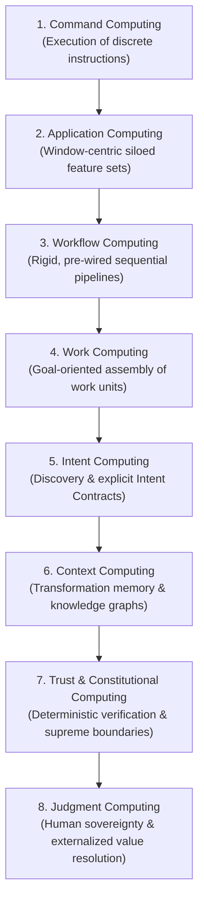
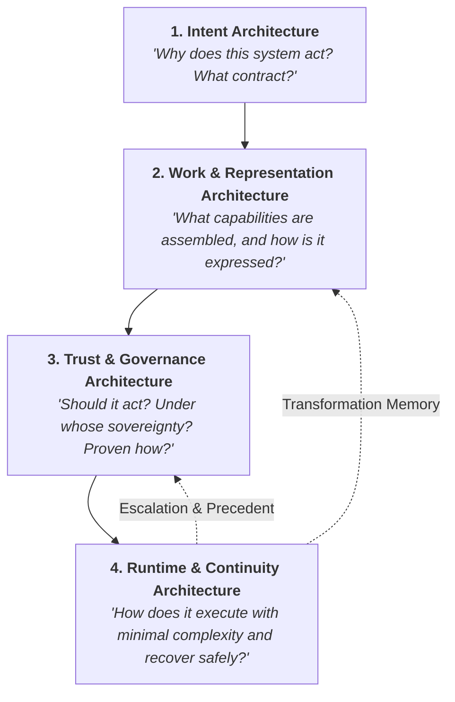
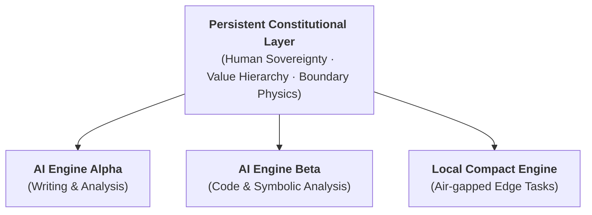

# Judgment Computing: Architectural Specification & Operating Model

> **Version 2.1.1** — November 2026  
> **Author**: YL Khim  
> **DOI**: [10.5281/zenodo.23388470](https://doi.org/10.5281/zenodo.23388470)  
> **License**: [Creative Commons Attribution 4.0 International (CC BY 4.0)](https://creativecommons.org/licenses/by/4.0/)  
> **Status**: Exploratory & Evolving Conceptual Specification (*Sections 1–4 align with the v2.0.1 baseline summarized in Appendices A–B of the published book; Section 5 and subsequent refinements remain experimental and subject to ongoing revision.*)

[English Manifesto](README.md) • [한국어 선언문](README.Ko.md) • [Architecture (EN)](ARCHITECTURE.md) • [아키텍처 (KO)](ARCHITECTURE.Ko.md) • [Glossary (EN)](GLOSSARY.md) • [용어집 (KO)](GLOSSARY.Ko.md)

---

## 1. The 8-Stage Evolutionary Paradigm

Computing evolves by reducing the "translation cost" between human intent and machine execution. Each paradigm introduces a higher-order primitive—representing a **conceptual abstraction ladder** rather than a strictly linear chronological timeline:



---

## 2. The Four Orthogonal Core Architectures

To realize Judgment-Aware Computing, systems must answer four distinct questions through four orthogonal architecture layers:



### Layer 1: Intent Architecture (Why & Contract)
- **Implicit Intent Discovery**: Engages in bi-directional dialogue to reveal missing constraints, risk profiles, and implicit goals.
- **Explicit Intent Contract**: Compiles conversational requirements into a binding operational specification.
- **Intent Preservation**: Guarantees that downstream runtime optimizers, routing engines, and autonomous tools never distort original human intent.

### Layer 2: Work & Representation Architecture (What & Memory)
- **Work Units & Composition**: Deconstructs monolithic applications into modular capabilities (*Components*) connected by behavioral rules (*Boundaries*). Work units can recursively contain other work units (*Recursive Work Nesting*).
- **Tri-View Semantic Representation**: A single canonical semantic model projected into three asymmetrically synchronized view lenses (exposing high-precision rules to beginner forms only through lossless preset projection rather than destructive compression):
  1. *Beginner Lens*: Simplified toggle options and high-level forms.
  2. *Intermediate Lens*: Visual flowchart and boundary wiring diagrams.
  3. *Expert Lens*: High-precision declarative rules and boundary code.
- **Transformation Memory**: Replaces transient conversational transcripts with a structured evolutionary record of work. By preserving the trajectory of how objectives and capabilities evolve (`Raw Log` → `Pattern Recognition` → `Reusable Work Knowledge`), the system maintains long-term contextual coherence without suffering from conversational context degradation.

### Layer 3: Trust & Governance Architecture (Authority & Constitution)
- **Normative Hierarchy**:
  > **Human Sovereignty → Values → Principles → Constitution → Policies → Runtime**
- **Physics Over Policy**: Restricts data movement and capabilities structurally at the enforcement and topology layer. Within the defined enforcement architecture and threat model, unauthorized paths expose no legitimate execution channel; semantic and payload-level risks within authorized channels are complemented by runtime verification and human judgment gates.
- **Verification Before Trust**: Separates capability from evaluation. Whatever can be proven is proven deterministically; semantic confidence scoring supplements only what remains.
- **Asymmetric Intervention (illustrative ratio 90 : 8 : 2)**:
  - **Most (e.g., 90%) — Silent Execution**: Pre-verified, boundary-contained routine tasks run without interrupting the user.
  - **Some (e.g., 8%) — Ambient Awareness**: Low-risk edge cases surface lightweight non-blocking previews.
  - **Few (e.g., 2%) — Synchronous Gate**: Irreversible actions, value collisions, or boundary breaches immediately halt execution and request human judgment.
- **Justified Override & Precedents**: In emergency or crisis situations, authorized humans may invoke time-bounded, scoped temporary exceptions to subordinate operational policies without modifying the underlying Constitution, disabling mandatory auditability, or bypassing inviolable constitutional floors and multi-principal safety vetoes (fail-closed). Human final authority does not assume human infallibility; rather, it binds non-transferable accountability, structured justification, and immutable precedent logs to every exception for subsequent audit.

### Layer 4: Runtime & Continuity Architecture (How & Resilience)
- **Deterministic Orchestration**: The execution engine does not deliberate on values; it strictly enforces the compiled execution graph (*Orchestrator, Not Judge*).
- **Compile Once, Verify Once, Execute Many**: Separates expensive semantic negotiation and static graph verification from low-latency execution, while lightweight runtime guards continuously re-verify live authority tokens and external preconditions (halting if invalidated).
- **Work Continuity & Recovery**: When errors occur, recovery targets the **work and intent**, not merely restarting a dead component.
  - *Tier 1 (Pre-approved Fallback Pool)*: Autonomous seamless rerouting within contract boundaries.
  - *Tier 2 (Governance Re-authorization)*: Unanticipated branches trigger escalation back to human authority.

---

## 3. Progressive Activation Model (L0 ~ L4)

To prevent cognitive and architectural bloat, systems follow the principle:  
> **Activate the minimum complexity required for success.**

```text
Level 4: Certified Governance & Multi-Tier Autonomous Recovery
         ▲
Level 3: Context Knowledge & Constitutional Governance Checks
         ▲
Level 2: Boundary Execution (Dynamic Conditions & Routing)
         ▲
Level 1: Work Surface Composition (Modular Capability Pairing)
         ▲
Level 0: Command Execution (Direct Tool / Action Invocation)
```

Lower levels never depend on higher-level machinery for pre-authorized, low-risk local tasks—a simple file-save runs at Level 0 without loading heavy governance or recovery subsystems. External side effects, sensitive data boundaries, and untrusted operations, however, cannot be arbitrarily downgraded to Level 0 to bypass higher-layer checks.

---

## 4. Preserving the Constitution, Replacing the Engines



Model architectures, reasoning engines, and LLM weights are volatile and replaceable. The Constitutional Layer remains independent, auditable, and structurally protected from unilateral mutation by the models themselves. Constitutional amendments occur strictly outside the runtime execution loop through explicit, verifiable authorization procedures—scaling from deliberate personal cryptographic confirmation in individual environments to physically isolated, multi-party approvals in enterprise environments.

---

## 5. Core Boundary Invariants & Design Guarantees

> **Scope of Conceptual Guarantees (Experimental Specification)**:  
> This specification does not disclose proprietary runtime engines, verification algorithms, internal data schemas, or compilation pipelines. Rather, it defines the **foundational security and continuity invariants** explored beyond the four core architectures. As an evolving conceptual and simulation-informed model—rather than a finalized industry standard or completed formal benchmark—these definitions and invariants remain experimental and subject to modification, refinement, and revision in future versions.

1. **Contract-Anchored Continuity and Drift Defense**:
   - State transition deltas (Δ) serve not only as transformation memory compression, but also as a pre-execution continuity signal against intent drift.
   - Relying solely on a short sliding window of recent steps fails to detect gradual multi-step escalations in cost, scope, or data sensitivity. Conformant systems evaluate **local transition deltas, cumulative single-session trajectories, and bounded cross-session principal windows against the immutable baseline of the original `Explicit Intent Contract`**. Legitimate workflow pivots re-anchor this baseline only through explicit **Human Assumption Shift Confirmation**, accompanied by a deterministic summary of how effective capabilities and data sensitivity differ from the original contract.

2. **Closing the Contract–Reality Gap via Deterministic Capability Summary Verification**:
   - When probabilistic AI translates natural-language requests into structured execution plans, its prose description (e.g., claiming "read-only") can diverge from actual compiled side-effects (**Contract–Reality Gap**).
   - Prior to promoting or authorizing a workflow for repeated execution, systems must present a **Compiled Capability Summary** derived deterministically from the executable structure rather than AI-generated prose—surfacing maximum external side-effects, external sensitive-data reachability and masking status, hard resource/destination ceilings, and synchronous human gate points. To prevent approval fatigue while closing prose misrepresentation, synchronous sign-off focuses strictly on elevated-risk boundaries (*Asymmetric Intervention*), noting that static capability summaries do not replace semantic payload inspection at runtime.

3. **Four Fail-Closed Admission Invariants**:
   - At the pre-execution verification boundary, violations of four structural invariants are rejected on a fail-closed basis:
     - **No Self-Certification (`Producer ≠ Verifier`)**: No workflow generator or AI component may serve as its own verification authority; compliance and safety verification must be grounded independently from generation (e.g., deterministic verification layers or independent evaluators).
     - **Zero-Grace Revocation on Irreversible Actions**: Upon a constitutional amendment, reversible low-risk workflows may enter a bounded re-verification queue, whereas workflows capable of irreversible external side-effects are invalidated immediately with zero grace window.
     - **All-Path Egress Sanitization**: Confidential data reaching any external sink must pass through enforced masking across **every reachable execution path**; partial masking on an individual branch is rejected as an unmasked leak.
     - **Lossless Representation Integrity**: High-precision behavioral rules must never be destructively flattened into oversimplified user controls in a lossy round-trip; restricted or simplified views must preserve full semantic constraints without silent truncation.

4. **Isolated Run-Local Recovery and Scoped Precedent Crystallization**:
   - When escalated human-reauthorized recovery is triggered beyond the pre-approved fallback pool, **Run-Local Exception Recovery** is strictly isolated from certified reusable templates: any ad-hoc single-run patch requires explicit human re-authorization and independent single-run verification while remaining strictly bounded within existing authorized permission scopes and constitutional ceilings—without mutating or contaminating the underlying template certification. Capability expansion beyond certified bounds or **Permanent Template Evolution** immediately invalidates prior certification for full re-verification.
   - Repeated, post-audit-safe **Justified Overrides** and verified exception paths may be promoted into formal scoped policies (**Precedent Crystallization**), strictly constrained beneath constitutional ceilings and human sovereignty.

---

## 6. Citation & Intellectual Property Notice

This architectural framework is published as an open, vendor-neutral specification to establish foundational terminology and prior art in systems engineering.

```bibtex
@article{khim2026judgmentarchitecture,
  author       = {Khim, Y. L.},
  title        = {Judgment Computing: Architectural Specification and Operating Model},
  year         = {2026},
  month        = nov,
  publisher    = {Zenodo},
  version      = {2.1.1},
  doi          = {10.5281/zenodo.23388470},
  url          = {https://doi.org/10.5281/zenodo.23388470}
}
```

Released under the **[Creative Commons Attribution 4.0 International (CC BY 4.0)](https://creativecommons.org/licenses/by/4.0/)** license.
