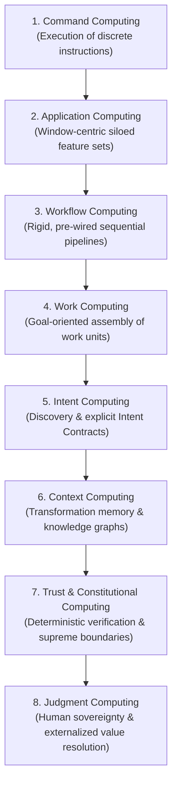
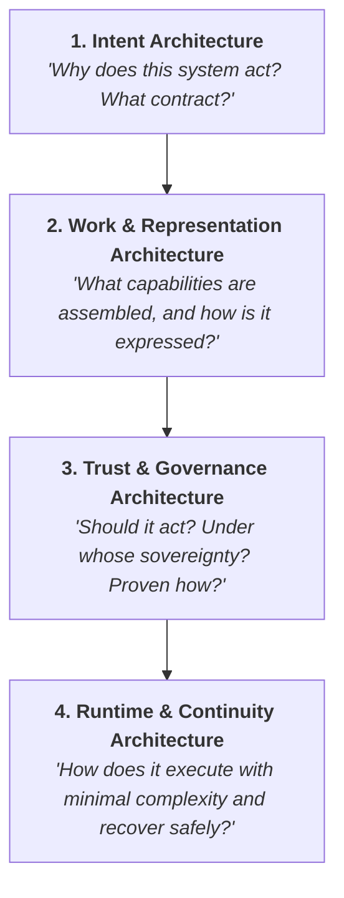
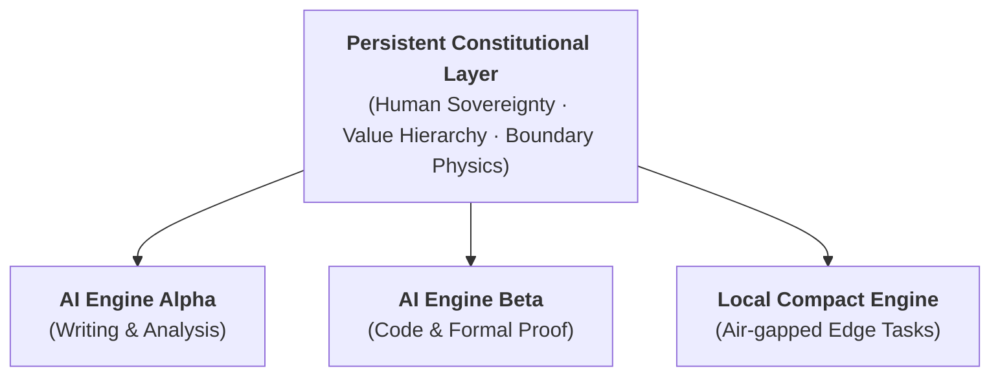

# Judgment Computing: Architectural Specification & Operating Model

> **Version 2.0.0** — November 2026  
> **Author**: YL Khim  
> **DOI**: [10.5281/zenodo.23388471](https://doi.org/10.5281/zenodo.23388471)  
> **License**: [Creative Commons Attribution 4.0 International (CC BY 4.0)](https://creativecommons.org/licenses/by/4.0/)

[English Manifesto](README.md) • [한국어 선언문](README.Ko.md) • [Architecture (EN)](ARCHITECTURE.md) • [아키텍처 (KO)](ARCHITECTURE.Ko.md) • [Glossary (EN)](GLOSSARY.md) • [용어집 (KO)](GLOSSARY.Ko.md)

---

## 1. The 8-Stage Evolutionary Paradigm

Computing evolves by reducing the "translation cost" between human intent and machine execution. Each paradigm introduces a higher-order primitive:



---

## 2. The Four Orthogonal Core Architectures

To realize Judgment-Aware Computing, systems must answer four distinct questions through four orthogonal architecture layers:



### Layer 1: Intent Architecture (Why & Contract)
- **Implicit Intent Discovery**: Engages in bi-directional dialogue to reveal missing constraints, risk profiles, and implicit goals.
- **Explicit Intent Contract**: Compiles conversational requirements into a binding operational specification.
- **Intent Preservation**: Guarantees that downstream runtime optimizers, routing engines, and autonomous tools never distort original human intent.

### Layer 2: Work & Representation Architecture (What & Memory)
- **Work Units & Composition**: Deconstructs monolithic applications into modular capabilities (*Components*) connected by behavioral rules (*Boundaries*). Work units can recursively contain other work units (*Recursive Work Nesting*).
- **Tri-View Semantic Representation**: A single canonical semantic model projected into three synchronizable view lenses:
  1. *Beginner Lens*: Simplified toggle options and high-level forms.
  2. *Intermediate Lens*: Visual flowchart and boundary wiring diagrams.
  3. *Expert Lens*: High-precision declarative rules and boundary code.
- **Transformation Memory**: Replaces transient conversational transcripts with a structured evolutionary record of work. By preserving the trajectory of how objectives and capabilities evolve (`Raw Log` → `Pattern Recognition` → `Reusable Work Knowledge`), the system maintains long-term contextual coherence without suffering from conversational context degradation.

### Layer 3: Trust & Governance Architecture (Authority & Constitution)
- **Normative Hierarchy**:
  > **Human Sovereignty → Values → Principles → Constitution → Policies → Runtime**
- **Physics Over Policy**: Restricts data movement and capabilities at the structural topology level. An unauthorized path has no physical channel.
- **Verification Before Trust**: Separates capability from evaluation. Whatever can be proven is proven deterministically; semantic confidence scoring supplements only what remains.
- **Asymmetric Intervention (illustrative ratio 90 : 8 : 2)**:
  - **Most (e.g., 90%) — Silent Execution**: Pre-verified, boundary-contained routine tasks run without interrupting the user.
  - **Some (e.g., 8%) — Ambient Awareness**: Low-risk edge cases surface lightweight non-blocking previews.
  - **Few (e.g., 2%) — Synchronous Gate**: Irreversible actions, value collisions, or boundary breaches immediately halt execution and request human judgment.
- **Justified Override & Precedents**: In emergency or crisis situations, authorized humans may invoke temporary exceptions to standard rules without modifying the underlying Constitution. The system records the operational context, justified rationale, and assumed risk into immutable precedent logs for subsequent audit.

### Layer 4: Runtime & Continuity Architecture (How & Resilience)
- **Deterministic Orchestration**: The execution engine does not deliberate on values; it strictly enforces the compiled execution graph (*Orchestrator, Not Judge*).
- **Compile Once, Verify Once, Execute Many**: Separates expensive semantic negotiation from low-latency, verifiable execution.
- **Work Continuity & Recovery**: When errors occur, recovery targets the **work and intent**, not merely restarting a dead component.
  - *Tier 1 (Pre-approved Fallback Pool)*: Autonomous seamless rerouting within contract boundaries.
  - *Tier 2 (Governance Re-authorization)*: Unanticipated branches trigger escalation back to human authority.

---

## 3. Progressive Activation Model (L0 ~ L4)

To prevent cognitive and architectural bloat, systems follow the principle:  
> **Activate the minimum complexity required for success.**

```text
Level 4: Certified Governance & Multi-Tier Autonomous Recovery
         ▲
Level 3: Context Knowledge & Constitutional Governance Checks
         ▲
Level 2: Boundary Execution (Dynamic Conditions & Routing)
         ▲
Level 1: Work Surface Composition (Modular Capability Pairing)
         ▲
Level 0: Command Execution (Direct Tool / Action Invocation)
```

Lower levels never depend on higher-level machinery. A simple file-save runs at Level 0 without loading governance or recovery subsystems.

---

## 4. Preserving the Constitution, Replacing the Engines



Model architectures, reasoning engines, and LLM weights are volatile and replaceable. The Constitutional Layer remains independent, auditable, and immutable by the models themselves. Changes to the Constitution require physically isolated, multi-party authorized procedures.

---

## 5. Citation & Intellectual Property Notice

This architectural framework is published as an open, vendor-neutral specification to establish foundational terminology and prior art in systems engineering.

```bibtex
@article{khim2026judgmentarchitecture,
  author       = {Khim, Y. L.},
  title        = {Judgment Computing: Architectural Specification and Operating Model},
  year         = {2026},
  month        = nov,
  publisher    = {Zenodo},
  version      = {2.0.0},
  doi          = {10.5281/zenodo.23388471},
  url          = {https://doi.org/10.5281/zenodo.23388471}
}
```

Released under the **[Creative Commons Attribution 4.0 International (CC BY 4.0)](https://creativecommons.org/licenses/by/4.0/)** license.
